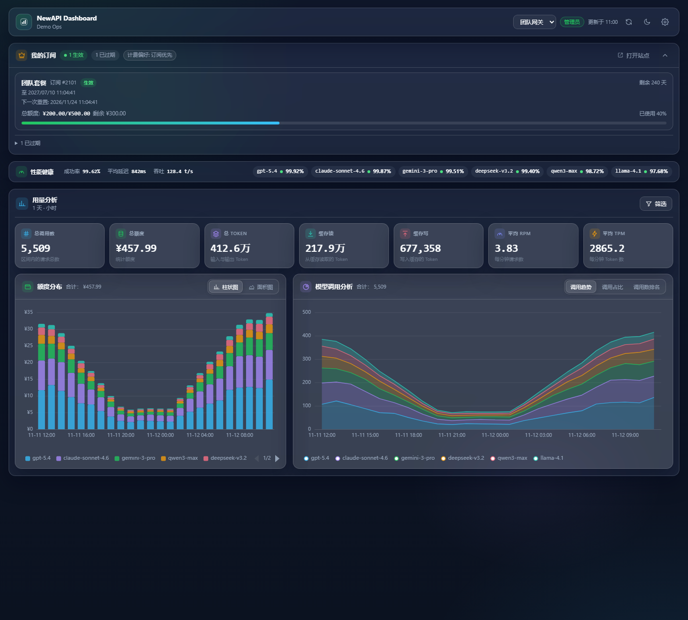
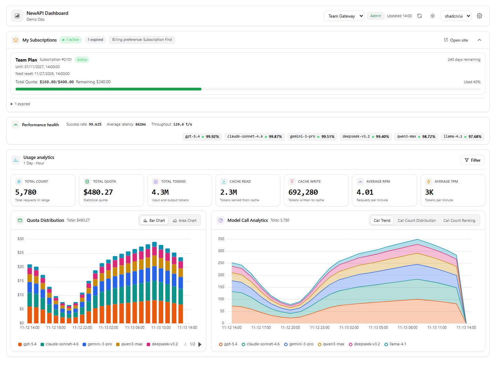
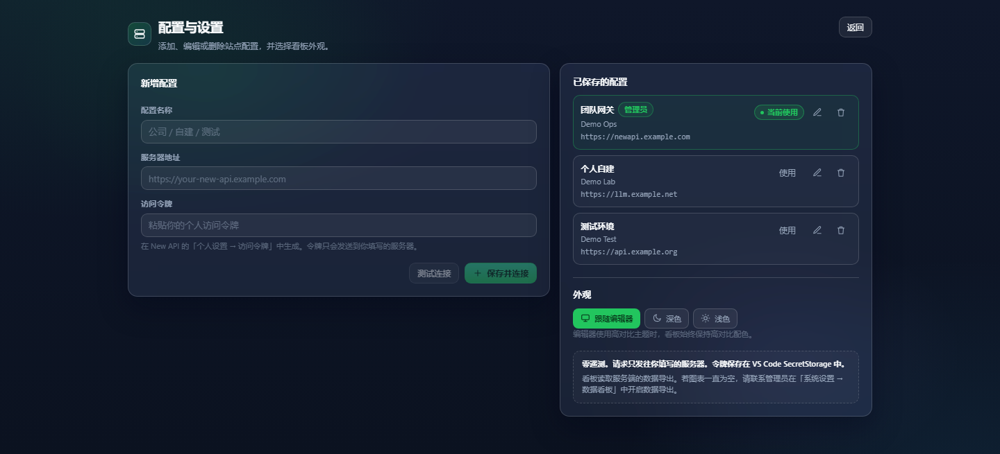
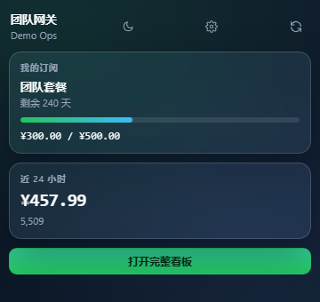

# NewAPI Dashboard

[](https://marketplace.visualstudio.com/items?itemName=y2kloong.new-api-dashboard)
[](https://open-vsx.org/extension/y2kloong/new-api-dashboard)
[](https://github.com/y2kloong/new-api-dashboard/releases)
[](https://github.com/y2kloong/new-api-dashboard/blob/main/LICENSE)

在 VS Code / Cursor 里直接查看 New API 的模型调用用量与订阅状态，不必再开浏览器。

> **非官方社区扩展。** 与 New API / QuantumNous 无从属关系，未获其背书。
> **Unofficial community extension.** Not affiliated with or endorsed by New API / QuantumNous.

**简体中文** | [English](#en)

## 截图 / Screenshots

> 截图中的站点、账号、模型和额度均为虚构演示数据，不包含任何真实站点、账号或令牌信息。
> All screenshots use fictional demo data. No real site, account or token is shown.



*深色主题：订阅、性能健康条、7 张指标卡、额度分布与模型调用分析。 / Dark theme with subscription, performance health, seven stat cards, quota distribution and model analytics.*



*浅色主题与英文界面。 / Light theme with the English UI.*



*统一的配置页：站点配置、令牌与外观。 / One configuration page for profiles, tokens and appearance.*



*活动栏 / 资源管理器侧边栏的紧凑概览。 / Compact overview in the activity bar or Explorer side bar.*

<a id="zh"></a>

## 简体中文

**目录**：[功能](#功能) · [安装](#安装) · [首次使用](#首次使用) · [兼容性](#兼容性) · [命令](#命令) · [设置](#设置) · [隐私与安全](#隐私与安全) · [已知限制与排错](#已知限制与排错) · [开发](#开发) · [参与贡献](#参与贡献) · [许可证](#许可证)

### 功能

- **用量总览**：总调用数、总额度、总 Token、缓存读、缓存写、平均 RPM、平均 TPM 共 7 张指标卡。
- **额度分布**：按时间桶和模型堆叠展示，支持柱状图 / 面积图切换。
- **模型调用分析**：调用趋势、调用占比、调用数排名三种视图；Top 12 之外的额度/调用归入「其他」，排名列表最多显示 20 个模型。
- **筛选**：1 / 7 / 14 / 29 天快捷区间、自定义起止时间、小时 / 天 / 周粒度；管理员还可以再按用户名筛选。
- **我的订阅**：套餐、状态、剩余天数、到期时间、下一次重置、额度已用 / 总额 / 剩余与进度条、计费偏好和站点链接；已过期 / 已取消订阅折叠展示。
- **多站点配置**：新增、编辑、测试、切换、删除站点配置；令牌保存在 VS Code `SecretStorage`，编辑时留空表示沿用原令牌。
- **管理员自动识别**：令牌角色 `role >= 10` 时改用全站数据；站点提供性能接口时显示性能健康条。
- **四个入口**：活动栏图标、资源管理器侧边栏概览、编辑器标签页全宽看板、状态栏摘要（点击打开看板）。
- **金额显示**：跟随服务端 `/api/status` 的 `quota_display_type`，支持 USD、CNY、Tokens 和自定义货币。
- **主题切换**：跟随编辑器 / 深色 / 浅色三种模式；编辑器和看板使用高对比主题时始终保持无障碍配色。
- **主题风格**：内置「玻璃拟态」「像素风」（Pixel Art）与「shadcn/ui」三套皮肤，看板头部用下拉框切换。皮肤只改变视觉语言——配色、圆角、边框、阴影、纹理与图表画法，布局、卡片和操作方式完全不变；深色 / 浅色 / 高对比编辑器下都可用。
- **统一的配置页**：站点配置与外观设置集中在同一处，不再有重复入口。
- **中英双语**：跟随编辑器语言，也可以在设置中手动指定。
- **自动刷新与离线兜底**：看板可见时按间隔自动刷新；刷新失败时保留最近一次成功快照，并显示「数据可能已过期」。

### 安装

扩展 ID：`y2kloong.new-api-dashboard`

#### 从市场安装（推荐）

- **VS Code**：在扩展视图搜索 **NewAPI Dashboard**，或执行：

```bash
code --install-extension y2kloong.new-api-dashboard
```

- **Cursor**：在扩展视图搜索 **NewAPI Dashboard**，或执行：

```bash
cursor --install-extension y2kloong.new-api-dashboard
```

- **其他 VS Code 兼容编辑器**：从 [Open VSX](https://open-vsx.org/extension/y2kloong/new-api-dashboard) 安装。

市场页面：[VS Code Marketplace](https://marketplace.visualstudio.com/items?itemName=y2kloong.new-api-dashboard) · [Open VSX](https://open-vsx.org/extension/y2kloong/new-api-dashboard)

#### 从 VSIX 安装

1. 从 [GitHub Releases](https://github.com/y2kloong/new-api-dashboard/releases) 下载 `new-api-dashboard-X.Y.Z.vsix`，把 `X.Y.Z` 换成实际版本号。
2. 安装：

```bash
code --install-extension new-api-dashboard-X.Y.Z.vsix
# 或
cursor --install-extension new-api-dashboard-X.Y.Z.vsix
```

也可以在扩展视图右上角 `...` → **Install from VSIX...** 选择文件。

> 仓库不提交 `.vsix` 文件，请从 Releases 或市场获取。

### 首次使用

1. 在 New API 站点生成访问令牌：**安全与访问 → 访问令牌**。
2. 打开命令面板，执行 **NewAPI Dashboard: Open Dashboard**（或点击活动栏图标）。
3. 填写服务器地址（例如 `https://newapi.example.com`）和令牌，点击 **保存并连接**。也可以先点 **测试连接** 验证地址和令牌。

> 看板读取服务端的「数据导出」。若图表为空，请管理员在 **系统设置 → 数据看板 → 数据导出** 中开启数据导出后刷新。

### 兼容性

- 按 New API 的接口实现：`/api/status`、`/api/user/self`、`/api/data`、`/api/data/self`、`/api/subscription/self`、`/api/subscription/plans`、`/api/perf-metrics/summary`。
- 只要站点提供上述接口即可工作；不同 New API 版本和二次开发站点的路由可能不同，本项目未对每个版本做穷举验证。
- one-api 及其他二次开发站点不保证兼容。
- 普通用户只能看到自己令牌对应的数据，这是服务端强制的。
- 管理员（`role >= 10`）改用全站数据并可按用户名筛选；性能健康条还需要站点提供 `/api/perf-metrics/summary`。
- 订阅区依赖 `/api/subscription/*`；站点没有该模块时整块自动隐藏。
- 需要 VS Code `1.85.0` 或更高版本；Cursor 等兼容编辑器需要支持 VS Code Webview API。

### 命令

| 命令 | 说明 |
| --- | --- |
| `NewAPI Dashboard: Open Dashboard` | 打开 / 聚焦看板 |
| `NewAPI Dashboard: Refresh Data` | 立即刷新 |
| `NewAPI Dashboard: Manage Server Profiles` | 打开配置页 |
| `NewAPI Dashboard: Show Logs` | 查看扩展日志 |

### 设置

| 设置项 | 默认 | 说明 |
| --- | --- | --- |
| `lyNewApi.autoRefreshMinutes` | `5` | 看板可见时的自动刷新间隔（分钟），`0` 关闭，最大 `120` |
| `lyNewApi.statusBar.enabled` | `true` | 是否显示状态栏摘要 |
| `lyNewApi.language` | `auto` | `auto` / `zh` / `en` |

图表类型、默认时间范围、主题等偏好保存在扩展自己的状态中，可在配置页或看板头部调整。

### 隐私与安全

- **零遥测**：不收集使用数据，不接入任何分析服务。
- **只连你配置的服务器**：请求只发往当前站点；Webview 的 CSP 使用 `connect-src 'none'`，禁止任何外连。
- **令牌只进 SecretStorage**：令牌保存在 VS Code `SecretStorage` 中，不写入 `settings.json`，不发送给 Webview，也不写进日志。
- **只读**：扩展不会购买套餐、修改订阅或更改任何计费偏好。
- **演示数据**：README 中的截图由本地预览生成，全部为虚构数据。
- 站点的用户名、套餐名、模型调用等数据只在你的编辑器和你的服务器之间传递。

### 已知限制与排错

- **图表为空 / 提示关闭数据导出**：请管理员开启 **系统设置 → 数据看板 → 数据导出**。数据导出关闭时扩展不会伪造数据。
- **401 / 403**：令牌无效、过期或没有读取该数据的权限；在配置页重新测试连接。
- **404**：地址可能不是 New API 站点，或站点路由与上面列出的接口不同；`https://host/dashboard`、`/console`、`/wallet` 这类页面地址会被自动归一化到站点根路径。
- **看不到订阅**：站点未提供 `/api/subscription/*`。
- **管理员看不到性能健康条**：令牌角色不是管理员，或站点未提供 `/api/perf-metrics/summary`。
- **one-api 兼容性**：不做保证；路由不同会导致请求失败。
- **只读**：不提供购买、充值、修改计费偏好等写操作。

### 开发

```bash
npm install
npm run watch      # 同时构建扩展宿主与 Webview
npm test           # 聚合 / 格式化（货币）/ 时间 / 订阅 / API 单元测试
npm run typecheck  # 扩展宿主 + Webview 类型检查
npm run build      # typecheck + test + compile
npm run package    # 打包 .vsix
```

在 VS Code 中按 `F5` 启动扩展开发宿主。

发布前必须更新 `package.json` 的 `version` 和 `CHANGELOG.md`；完整发布流程见 [`docs/publishing.md`](https://github.com/y2kloong/new-api-dashboard/blob/main/docs/publishing.md)。

### 参与贡献

- [`CONTRIBUTING.md`](https://github.com/y2kloong/new-api-dashboard/blob/main/CONTRIBUTING.md)
- [`CHANGELOG.md`](https://github.com/y2kloong/new-api-dashboard/blob/main/CHANGELOG.md)
- [`docs/publishing.md`](https://github.com/y2kloong/new-api-dashboard/blob/main/docs/publishing.md)
- [`docs/icon-credits.md`](https://github.com/y2kloong/new-api-dashboard/blob/main/docs/icon-credits.md)
- [GitHub Issues](https://github.com/y2kloong/new-api-dashboard/issues)

### 许可证

MIT。见 [LICENSE](https://github.com/y2kloong/new-api-dashboard/blob/main/LICENSE)。

<a id="en"></a>

## English

**Contents:** [Highlights](#highlights) · [Install](#install) · [Setup](#setup) · [Compatibility](#compatibility) · [Commands](#commands) · [Settings](#settings) · [Privacy and security](#privacy-and-security) · [Known limitations and troubleshooting](#known-limitations-and-troubleshooting) · [Development](#development) · [Contributing](#contributing) · [License](#license)

### Highlights

- **Usage overview**: seven stat cards for total calls, total quota, total tokens, cache read, cache write, average RPM and average TPM.
- **Quota distribution**: stacked by time bucket and model, with a bar / area chart switch.
- **Model call analytics**: trend, call-count distribution and call-count ranking; quota and calls outside the top 12 models are grouped as "Other", and the ranking lists up to 20 models.
- **Filters**: 1 / 7 / 14 / 29-day presets, a custom start and end time, and hour / day / week granularity. Administrators can also filter by username.
- **Subscriptions**: plan, status, remaining days, expiry, next reset, used / total / remaining quota with a progress bar, billing preference and a link to the site wallet. Expired and cancelled subscriptions are collapsed.
- **Multiple server profiles**: add, edit, test, switch and delete profiles. Tokens live in VS Code `SecretStorage`; leaving the token field blank while editing keeps the saved token.
- **Admin detection**: tokens with `role >= 10` switch to site-wide data, and the performance health strip appears when the site exposes the performance endpoint.
- **Four entry points**: activity bar view, Explorer side bar overview, full-width editor tab, and a status bar summary that opens the dashboard.
- **Currency display**: follows `quota_display_type` from `/api/status` and supports USD, CNY, tokens and custom currencies.
- **Theme switch**: follow the editor, dark or light. High-contrast editor themes always keep their accessible palette.
- **Theme style**: three skins — *Glass*, *Pixel Art* and *shadcn/ui* — picked from a dropdown in the dashboard header. A skin only swaps the visual language (palette, radii, borders, shadows, texture and chart rendering); layout, cards and controls stay the same. All three work in dark, light and high-contrast editors.
- **One configuration page**: profiles and appearance in a single place, with no duplicate entry points.
- **English / Chinese**: follows the editor language and can also be set explicitly.
- **Auto refresh and offline fallback**: refreshes on an interval while a dashboard is visible; a failed refresh keeps the last successful snapshot and marks the data as possibly stale.

### Install

Extension ID: `y2kloong.new-api-dashboard`

#### From a marketplace (recommended)

- **VS Code**: search for **NewAPI Dashboard** in the Extensions view, or run:

```bash
code --install-extension y2kloong.new-api-dashboard
```

- **Cursor**: search for **NewAPI Dashboard** in the Extensions view, or run:

```bash
cursor --install-extension y2kloong.new-api-dashboard
```

- **Other VS Code-compatible editors**: install from [Open VSX](https://open-vsx.org/extension/y2kloong/new-api-dashboard).

Marketplace pages: [VS Code Marketplace](https://marketplace.visualstudio.com/items?itemName=y2kloong.new-api-dashboard) · [Open VSX](https://open-vsx.org/extension/y2kloong/new-api-dashboard)

#### From a VSIX

1. Download `new-api-dashboard-X.Y.Z.vsix` from [GitHub Releases](https://github.com/y2kloong/new-api-dashboard/releases) and replace `X.Y.Z` with the actual version.
2. Install it:

```bash
code --install-extension new-api-dashboard-X.Y.Z.vsix
# or
cursor --install-extension new-api-dashboard-X.Y.Z.vsix
```

Or use **Extensions: Install from VSIX...** from the Extensions view.

> The repository does not commit `.vsix` files; download them from Releases or install from a marketplace.

### Setup

1. Create an access token in New API: **Security & Access → Access tokens**.
2. Open the command palette and run **NewAPI Dashboard: Open Dashboard** (or click the activity bar icon).
3. Enter the server URL (for example `https://newapi.example.com`) and the token, then click **Save and connect**. You can use **Test connection** first to verify both values.

> The dashboard reads the server-side data export. If charts stay empty, ask an administrator to enable data export under **System settings → Dashboard → Data export**, then refresh.

### Compatibility

- Implemented against New API's `/api/status`, `/api/user/self`, `/api/data`, `/api/data/self`, `/api/subscription/self`, `/api/subscription/plans` and `/api/perf-metrics/summary` endpoints.
- Any site that exposes those endpoints should work. Routes can differ across New API versions and forks, and this project has not been validated against every version.
- one-api and other forks are not guaranteed to work.
- Non-admin tokens can only see their own data; the server enforces this.
- Admin tokens (`role >= 10`) switch to site-wide data and can filter by username. The performance health strip additionally requires `/api/perf-metrics/summary`.
- The subscription section depends on `/api/subscription/*` and is hidden when the site does not provide it.
- Requires VS Code `1.85.0` or newer. Cursor and other compatible editors must support the VS Code Webview API.

### Commands

| Command | Description |
| --- | --- |
| `NewAPI Dashboard: Open Dashboard` | Open or focus the dashboard |
| `NewAPI Dashboard: Refresh Data` | Refresh immediately |
| `NewAPI Dashboard: Manage Server Profiles` | Open the configuration page |
| `NewAPI Dashboard: Show Logs` | Show the extension log |

### Settings

| Setting | Default | Description |
| --- | --- | --- |
| `lyNewApi.autoRefreshMinutes` | `5` | Auto refresh interval in minutes while a dashboard is visible; `0` disables it, maximum `120` |
| `lyNewApi.statusBar.enabled` | `true` | Show the status bar summary |
| `lyNewApi.language` | `auto` | `auto` / `zh` / `en` |

Chart type, default time range and theme live in the extension's own state and are changed from the configuration page or the dashboard header.

### Privacy and security

- **No telemetry**: no usage data is collected and no analytics service is used.
- **Only your server**: requests go only to the configured site. The webview CSP uses `connect-src 'none'` and blocks any outbound connection.
- **Tokens stay in SecretStorage**: tokens are stored in VS Code `SecretStorage`, never written to `settings.json`, never sent to the webview and never written to logs.
- **Read-only**: the extension never buys plans, changes subscriptions or changes billing preferences.
- **Demo data**: the screenshots in this README were generated from a local preview with fictional data.
- Site data such as usernames, plan names and model usage only travels between your editor and your server.

### Known limitations and troubleshooting

- **Empty charts / data export disabled**: ask an administrator to enable **System settings → Dashboard → Data export**. The extension never fabricates data when the export is off.
- **401 / 403**: the token is invalid, expired or lacks permission to read the data; test the connection again from the configuration page.
- **404**: the URL may not be a New API site, or its routes differ from the endpoints listed above. Page URLs such as `https://host/dashboard`, `/console` and `/wallet` are normalized to the site root automatically.
- **No subscription section**: the site does not provide `/api/subscription/*`.
- **No performance health strip for administrators**: the token is not an admin token, or the site does not provide `/api/perf-metrics/summary`.
- **one-api compatibility**: not guaranteed; different routes will cause requests to fail.
- **Read-only**: purchases, top-ups and billing-preference changes are out of scope.

### Development

```bash
npm install
npm run watch      # rebuild extension and webview on change
npm test           # aggregation / formatting (currency) / time / subscription / API unit tests
npm run typecheck  # extension host + webview type check
npm run build      # typecheck + test + compile
npm run package    # produce the .vsix
```

Press `F5` in VS Code to launch an extension development host.

Before packaging, bump `version` in `package.json` and update `CHANGELOG.md`. The full release runbook is in [`docs/publishing.md`](https://github.com/y2kloong/new-api-dashboard/blob/main/docs/publishing.md).

### Contributing

- [`CONTRIBUTING.md`](https://github.com/y2kloong/new-api-dashboard/blob/main/CONTRIBUTING.md)
- [`CHANGELOG.md`](https://github.com/y2kloong/new-api-dashboard/blob/main/CHANGELOG.md)
- [`docs/publishing.md`](https://github.com/y2kloong/new-api-dashboard/blob/main/docs/publishing.md)
- [`docs/icon-credits.md`](https://github.com/y2kloong/new-api-dashboard/blob/main/docs/icon-credits.md)
- [GitHub Issues](https://github.com/y2kloong/new-api-dashboard/issues)

### License

MIT. See [LICENSE](https://github.com/y2kloong/new-api-dashboard/blob/main/LICENSE).
